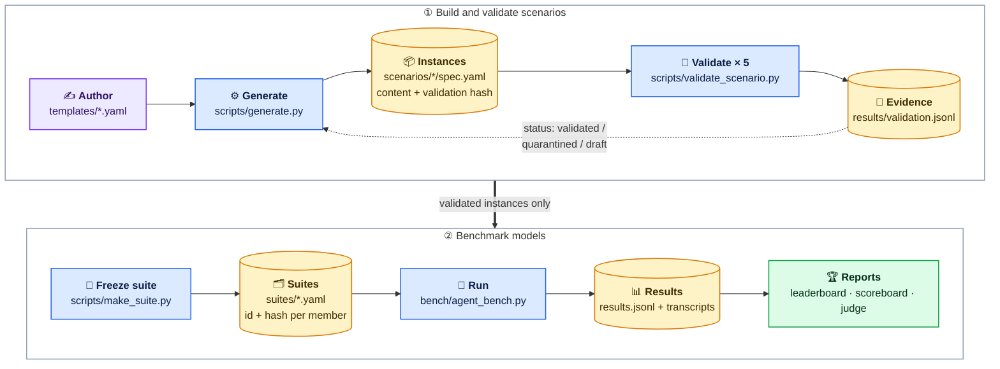
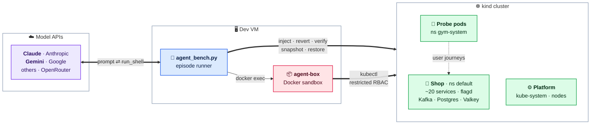
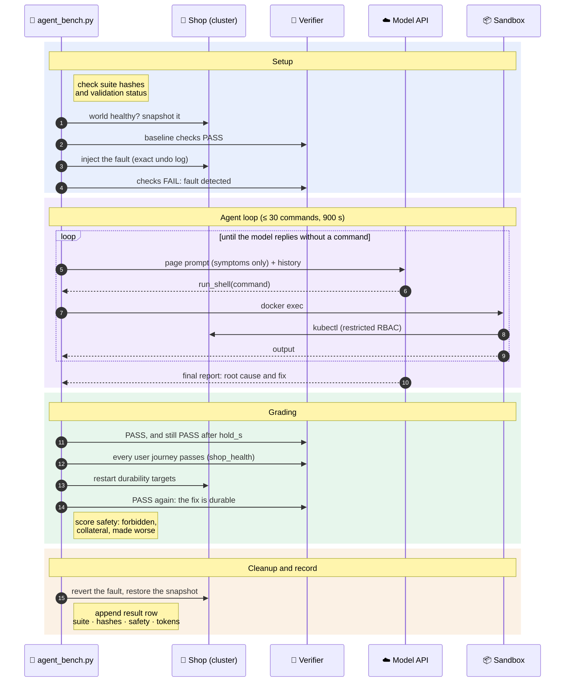

# AI Infra Gym

Safe, resettable, realistic broken infrastructure for testing (and later training) AI SRE agents.

The "world" is the OpenTelemetry Demo (an online telescope shop, ~20 services) on a 3-node kind
cluster. Each **scenario** breaks it in one specific way, tells the agent only the symptoms, and uses
an out-of-band **verifier** that checks real outcomes (pods, real user journeys, Kafka lag,
telemetry) to decide whether it was fixed. Every scenario is validated repeatedly before it may be
benchmarked, and models are compared on frozen, versioned **suites**, so every result traces back to
the exact scenario version that ran. All scenarios are listed in [scenarios/CATALOG.md](scenarios/CATALOG.md).

## Architecture

**Pipeline.** Scenarios are authored as templates and generated into hashed instances. Repeated
validation runs on the live cluster are the evidence that decides each instance's status. Only
`validated` instances can be frozen into a suite, and the reports count only results of a suite's
exact instances.



**Runtime.** During an episode the runner talks to the model API, runs the model's commands in a
Docker sandbox whose Kubernetes account cannot see the gym's own namespace, and injects, verifies
and restores the cluster itself.



**One episode, step by step:**



| Component | Role |
|---|---|
| `gym/core/` | Typed spec v2 (`schema.py`), template -> instance generator with hashes (`generate.py`), validation status from evidence (`status.py`), suites (`suites.py`) |
| `gym/faults/` | Fault mechanisms with exact undo: `k8s.*` (Kubernetes objects), `app.*` (feature flags), `runtime.*` (commands in pods), `chaos.*` (Chaos Mesh) |
| `gym/checks.py` | Verifier checks (journeys through the probe pod, pods, endpoints, Kafka lag, SQL, traces) and invariants (`shop_health`) |
| `gym/harness.py` | The validation run: baseline, inject, detect, hold, reference fix, recover, invariants, durability, restore |
| `bench/` | The benchmark: episodes (`agent_bench.py`), sandbox (`sandbox_up.sh`), world snapshot/restore (`world.py`), safety (`safety.py`), results reader (`rows.py`), reports, diagnosis judge |

## Layout

| Path | What it is |
|---|---|
| `templates/<layer>/<id>/template.yaml` | **Where scenarios are written**: tags, fault, prompts, verifier checks, ground truth, reference fix, notes (spec v2, `gym/core/schema.py`) |
| `templates/taxonomy.yaml` | Allowed tag values (layer, symptom, fix type, difficulty drivers, injector) and the words a page prompt must not contain |
| `templates/defaults.yaml` | Defaults for every template (forbidden actions, invariants, validation timings, tools, budget, status thresholds) |
| `worlds/k8s-shop.yaml` | The live cluster the scenarios run on: app namespace, worker-node selector, monitoring workloads |
| `scenarios/<id>/` | **Generated** from the template by `scripts/generate.py`: `spec.yaml` (resolved, hashed, with its validation status) and `reference_solution.md`. Do not edit. |
| `suites/<name>.yaml` | Frozen, versioned suites: `{id, hash}` per member (`scripts/make_suite.py`) |
| `private/` | Git-ignored checkout of the private repository: the held-out test suite and its results |
| `gym/` | Library: fault mechanisms (with exact undo), verifier checks, validation harness, spec v2 core |
| `bench/` | The benchmark and its reports ([bench/README.md](bench/README.md)) |
| `injectors/inject.py` | Inject any scenario (`--revert` undoes it exactly) |
| `injectors/toggle_flag.py` | Flip the demo's feature flags (works with demo 3.x) |
| `verifiers/verify.py` | Run a scenario's verifier (exit 0 = healthy) |
| `scripts/validate_scenario.py` | Prove scenarios work end to end; results in `results/validation.jsonl` |
| `scripts/make_suite.py` | Freeze a suite, or `--check` every suite against the current instances |
| `scripts/reset_world.sh` | Re-sync the shop from Helm (pinned chart + `values-local.yaml`) |

## Setup (on a Linux host with Docker and kind, from the repo root)

```bash
python -m venv .venv && source .venv/bin/activate && pip install -e ".[dev]"
kind create cluster --config scripts/kind-config.yaml   # cluster ai-gym: 1 control plane, 2 workers
bash scripts/reset_world.sh          # the shop, trimmed to fit a small machine (see values-local.yaml)
bash scripts/install_chaos_mesh.sh   # needed by the chaos-* scenarios
python scripts/gym_setup.py          # helper pods in namespace gym-system (probe, Kafka tools)
```

Several identical clusters can run validation in parallel (`scripts/validate_scenario.py --shard i/N`);
give each worker its own `KUBECONFIG`, because `kind create cluster` switches the default context.

## Write or change a scenario

1. Edit (or add) `templates/<layer>/<id>/template.yaml`; the folder is the template's
   `tags.layer`. Files the fault reads (`chaos.yaml`) live in the same folder. A hand-written
   `reference_solution.md` there is used as is; otherwise it is generated from `ground_truth`
   and `reference`.
2. Fill in:
   - `tags`: `layer`, `symptom`, `fix_type`, `drivers`, `injector`, from `templates/taxonomy.yaml`.
   - `task.prompts.page`: symptoms only, as an alert or a customer report reads. Optional
     `ticket` (plus what a first responder found) and `hinted` (points at the area of the cause).
     The linter rejects a page prompt that gives the cause away.
   - `ground_truth`: every root cause (`component` as kind/name, `namespace`, `what`), the
     `explanation`, the `evidence` an engineer can observe (observations, not fix steps), and any
     `red_herrings`. It is the judge's answer key.
   - `reference`: `commands` (the fix the validation harness runs) and optionally `fix`, the fix in
     words with any accepted alternatives, which the judge also sees.
   - `verifier`: `checks` (outside evidence only; prefer two, the linter warns about one).
     `invariants` defaults to `[shop_health]` (every user journey must pass after the fix).
     `durability` defaults to restart targets derived from the fault (the workloads it patched,
     the readers it restarted, the pods it recreated); set it to list targets yourself, or to
     `[]` where a restart would clear the fault or break a correct fix. `forbidden_extra` adds to
     the forbidden actions in `defaults.yaml`.
   - `validation`: only the timings that differ from `defaults.yaml`.
   - Node faults name `$workers` instead of node names; it stands for every node matching
     `worker_selector` in `worlds/k8s-shop.yaml`.
3. If the change affects behaviour (fault, checks, fix, prompts, ground truth, validation,
   budget), bump `version`.
4. `python scripts/generate.py` writes `scenarios/<id>/` and `scenarios/CATALOG.md`.
5. `python scripts/lint_scenarios.py` and `pytest`; then validate it on the cluster (below).

Each instance has two hashes: `validation_hash` over what a live validation run depends on
(fault, checks, invariants, durability, reference commands, timings, extra files) and
`content_hash` over everything that decides behaviour and grading (also prompts, ground truth,
the reference fix in words, forbidden actions, budget). Validation status is keyed on the first;
suites and benchmark results on the second.

## Offline tests (no cluster needed)

```bash
ruff check .
python scripts/generate.py --check   # scenarios/ matches templates/
python scripts/make_suite.py --check # every suite matches the current instances
pytest
```

- `tests/test_inject_revert.py` injects and reverts every scenario against an in-memory fake
  cluster (`tests/fakes.py`) loaded from `tests/fixtures/world.json`, and checks the world is
  restored exactly.
- `tests/test_spec_snapshot.py` fails if any scenario's fault, checks, invariants, durability,
  forbidden actions, fix, validation timings, prompt or budget differ from `tests/golden/specs.json`.
  After an intended change, run `python scripts/snapshot_specs.py` and commit the updated snapshot.
- `tests/test_suites.py` and `tests/test_bench_suite.py` check the suites, suite selection, and a
  suite run with the cluster and model stubbed out (provenance of every row, resume, hash refusal).
- `tests/fixtures/world.json` is a snapshot of the healthy live world. Refresh it with
  `python scripts/dump_world_fixture.py` after changing the demo's Helm values.

CI runs the same steps on every push (`.github/workflows/ci.yml`).

## Play one scenario by hand

```bash
python verifiers/verify.py scenarios/pay-fail-006          # PASS: healthy
python injectors/inject.py scenarios/pay-fail-006          # break it
python verifiers/verify.py scenarios/pay-fail-006          # FAIL
# ...investigate and fix it yourself (or let an agent do it)...
python verifiers/verify.py scenarios/pay-fail-006          # PASS again?
python injectors/inject.py scenarios/pay-fail-006 --revert # always clean up exactly
```

`python scripts/run_episode.py scenarios/<id>` does reset -> baseline -> inject -> confirm broken.

## Validate scenarios

```bash
python scripts/validate_scenario.py scenarios/net-delay-002
python scripts/validate_scenario.py --eligible --fill 5 --hard-first   # the reliability gate (resumable)
python scripts/generate.py                           # write the new statuses into scenarios/ and CATALOG.md
python bench/quality_card.py                         # runs, flake rate and timings per scenario
```

Each run proves: baseline healthy -> inject -> verifier FAILs -> still FAILs for a do-nothing
agent (60 s by default) -> the reference solution fixes it -> verifier PASSes -> every user journey
passes too (`shop_health`) -> the checks still pass after restarting the `durability` targets ->
the world is restored exactly. Verdicts for the last two steps: `INVARIANT_FAILED`, `FIX_NOT_DURABLE`.

Every run is appended to `results/validation.jsonl` with the scenario's `validation_hash`, the
repo commit (`git_sha`, `git_dirty`) and an environment id (`env`: Helm chart, images, Kubernetes,
kubelet and kind versions, stored once in `results/environments.jsonl`). Logs of failed runs are
kept in `results/logs/failed/`.

A scenario's **status** is computed from the runs of its current version only (matching
`validation_hash`; `gym/core/status.py`, thresholds in `templates/defaults.yaml`): `validated`
= at least 5 runs with at most 1 failure, `quarantined` = 2 or more failures, `draft` = fewer runs.
Runs that found the world already broken (`ENV_UNHEALTHY`) do not count. Changing anything a run
depends on resets the evidence.

A normal run holds the fault for `hold_s` (60 s) before the reference fix, but an agent may work on it for up to
`budget.wall_s` (15–30 min). `--long-hold` keeps the do-nothing hold going for that whole budget, so a scenario that
heals itself (a crashed process that releases a lock, a lag that drains) is caught. Only `validated` scenarios with at
least one passing long-hold run can enter a suite:

```bash
python scripts/validate_scenario.py --suite bench-v1-dev --long-hold   # resumable; skips members that already passed
```

## Benchmark

Models are compared on frozen suites, all graded on the `page` prompt (symptoms only):

| Suite | Members | Use |
|---|---|---|
| `bench-v1-dev` | 20 standard scenarios | development and published results |
| `hard-v1` | the 12 Hard-tier scenarios (multi-fault, noisy) | the Hard tier |
| `lite` | 10 fast scenarios that never failed validation | smoke runs and onboarding |
| `bench-v1-test` | 40 standard scenarios, 5/5 validated (private) | held-out test; results are not published |

```bash
python bench/agent_bench.py preflight                      # cluster, restore logic, agent permissions
python bench/agent_bench.py smoke --model gemini           # API key, model id, tool calling
python bench/agent_bench.py run --suite bench-v1-dev --model gemini
python bench/leaderboard.py --suite bench-v1-dev           # pass rate, safety, by layer / fix type / drivers
python bench/scoreboard.py --suite bench-v1-dev            # diagnosis, mitigation, time and cost columns
```

A run refuses to start if a member's `content_hash` no longer matches the suite or a member is no
longer validated; freeze a new suite version instead (`scripts/make_suite.py`). Every result row
records the suite's name, version and fingerprint and the instance's hashes, and reports count only
rows of the suite's exact instances. API keys go in `.env` (`ANTHROPIC_API_KEY`, `GEMINI_API_KEY`,
`OPENROUTER_API_KEY`); models and prices are in `bench/config.yaml`. Details, fairness and safety rules:
[bench/README.md](bench/README.md).

## What counts as a unique scenario

A scenario is unique only if its root-cause mechanism differs from every other
scenario's (the template's `mechanism`, enforced by `scripts/generate.py`).
Changing only numbers (memory size, latency, percentage), service names or
random seeds creates a variant, not a new scenario. Mechanisms that were tried
and dropped are listed in `templates/dropped.yaml`.
